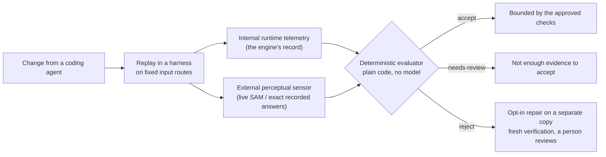

<p align="center">
  <a href="https://expectrail.tech">
    <picture>
      <source media="(prefers-color-scheme: dark)" srcset="docs/brand/expectrail-logo-reverse.svg">
      
    </picture>
  </a>
</p>

<p align="center"><strong> Independent verification for coding agents’ changes: the runtime’s record and vision must agree, and plain code decides.</strong></p>

<p align="center">
  <a href="https://github.com/Expectrail/Expectrail/actions/workflows/ci.yml"></a>
  <a href="LICENSE"></a>
  
  <a href="docs/capabilities.md"></a>
</p>

<p align="center">
  <a href="https://expectrail.tech">Website</a> ·
  <a href="https://expectrail.tech/quickstart.html">Quickstart</a> ·
  <a href="docs/concepts.html">Concepts</a> ·
  <a href="docs/guides.html">Guides</a> ·
  <a href="docs/positioning.html">Positioning</a> ·
  <a href="docs/capabilities.md">Evidence ledger</a>
</p>

# Expectrail

```sh
python3 -m pip install .
```

Run this in a checkout with Python 3.12+ in a virtual environment; it is not on PyPI.
For a built wheel, use `python3 -m pip install ./dist/expectrail-0.1.0-py3-none-any.whl`.
The [pinned sample container](docs/install.md#recorded-sample-profile) selects bundled recorded
vision explicitly: `expectrail doctor`, then `expectrail sample`, with real Godot replays and no
model calls. An unmatched image/question needs review. Ordinary verification still requires its
own visual evidence; the no-vision quickstart below retains its incomplete results.

**Coding agents write changes at machine speed. Expectrail checks their behavior on approved checks and routes; opt-in repair proposes patches for a person to review.**

Autonomous coding agents can make unit tests pass while breaking the running software: drawing a character inside
the floor, hiding a checkout button behind a banner, failing to render a texture, or disabling a feature to silence a
failing check.

The installed command replays Godot changes against approved checks and cross-examines
**internal runtime telemetry** against **external visual observation** (live SAM or configured exact recorded answers). Historical agent benchmarks also used Muse Glimmer 30B. Generated per-change checks remain advisory. It
uses **plain deterministic code—never a model**—to report **accept**, **reject** or **needs-review**. When a check
catches a defect and you turn auto-fix on, a fixer proposes a patch on a separate copy under the configured sandbox policy, a fresh verification judges each
candidate, and a person reviews any accepted patch. [Capability ledger: installed command — integrated, diagnostic](docs/capabilities.md#installed-command).



Models observe, plan and patch. Plain code decides pass or fail. An accept requires both the runtime’s internal record
and external vision to agree.

## Why single-channel verification fails

We measured three verification structures against the same 8 held-out bugs (`physics-fall-through`,
`missing-texture`, `layering`, `sinking`), 8 valid fixes and 7 deceptive fixes that look plausible on the surface.

| Verification architecture | Held-out bugs caught | Deceptive fixes accepted | Valid fixes falsely rejected |
| --- | --- | --- | --- |
| Internal telemetry / code checks alone (vision off) | [4 of 8](bench/detection/README.md) | [3 of 7](bench/judge/glimmer/README.md) | 0 of 8 |
| A model judging screenshots alone | Not a deterministic gate | [2 of 7](bench/judge/README.md) (Muse Code) | [1 to 2 of 8](bench/judge/README.md) (Muse) · [5 of 10](bench/mutation/ai-fixes/README.md) on mutation repairs · [1 to 5 of 24](bench/judge/outside-models/README.md) (frontier models) |
| **Expectrail: vision × runtime record → deterministic evaluator** | **[8 of 8](bench/detection/README.md)**, no false alarm on the clean build | **[0 of 7](bench/judge/glimmer/README.md)** (SAM 3.1, and Glimmer + engine) | **0 of 8** (8 of 8 valid fixes accepted) |

Telemetry alone misses what is drawn: coordinates look normal while a coin texture fails to render or a character is
hidden behind scenery. A screenshot judge hallucinates: Muse Code accepted a robot drawn inside the ground, and
frontier models rejected working code. Recorded runs: held-out detection [41003749744](https://github.com/Expectrail/Expectrail/actions/runs/41003749744) and
[41003751876](https://github.com/Expectrail/Expectrail/actions/runs/41003751876); targeted wrong fixes [41268021760](https://github.com/Expectrail/Expectrail/actions/runs/41268021760) (31 of 39 caught, 24 needing SAM; all
8 misses from one no-op mutation operator); open-weight Glimmer + engine [41230177124](https://github.com/Expectrail/Expectrail/actions/runs/41230177124), where 1 of 7
deceptive fixes passed every public check under Glimmer and was stopped only by a private held-out route.

## Get started

| I want to | Start here |
| --- | --- |
| Install and run the sample, spending nothing | [Six-step quickstart](https://expectrail.tech/quickstart.html) · [Install](#install) |
| Verify pull requests to a game in CI | [GitHub Action guide](docs/guides.html#action) |
| Try a repair after a reject | [Verify, then repair](#verify-then-repair) |
| Bring my own model, vision backend or coding agent | [Providers guide](docs/guides.html#providers) · ledger rows: [models](docs/capabilities.md#byo-models), [vision](docs/capabilities.md#byo-vision), [fixer](docs/capabilities.md#byo-fixer) |
| Know what a verdict does and does not establish | [Concepts](docs/concepts.html) · [What a result means](#what-a-result-means) |
| Check a claim on this page | [Capability ledger](docs/capabilities.md): every row names its test, record or run, and its limits |

## Install

```sh
python3 -m pip install .
```

Run that in a checkout, using a Python 3.12+ virtual environment. The packaged path is Linux;
it is **not on PyPI**. The [six-step quickstart](https://expectrail.tech/quickstart.html) covers
installation, `doctor`, `sample` and a project given by path.
[Install scope and evidence](docs/capabilities.md#installed-command).

<details>
<summary>Prerequisites</summary>

Before replaying, Linux needs `xvfb-run` (Ubuntu packages `xvfb` and `xauth`),
software OpenGL (`libgl1-mesa-dri` and `libglx-mesa0`), `patch`, `curl` and `unzip`.
Keep at least **1 GiB free** on the filesystems used by the engine cache and temporary
files; recordings may need more. Doctor labels this threshold 1024 MB, reports each
location, and suggests freeing space or choosing other folders. A missing display leaves OpenGL untried and blocks replays too.
Bubblewrap is optional for this walkthrough; isolated verification requires it and
kernel support. Vision settings remain intentionally absent for the no-spend walkthrough.
[Prerequisites and install scope](docs/capabilities.md#installed-command) ·
[Sandbox limits](docs/capabilities.md#replay-sandbox).

</details>

## Start with an honest result

The quickstart deliberately uses no vision credentials and makes no model calls. Its expected
sample decisions are **needs-review / reject / needs-review**. Missing `MODEL_API_KEY` or
`EXPECTRAIL_SAM_USD_CAP` leaves passing engine checks needing review; an engine failure can still
reject. The current vision default is tested offline; the ledger's cited installed-command live
run predates it. [Installed command](docs/capabilities.md#installed-command) ·
[Orchestrator and vision requirement](docs/capabilities.md#orchestrator).

`expectrail doctor` names missing prerequisites. `expectrail report` shows a job's decision and
where its evidence is. The commands and expected nonzero exits are explained together in the
[quickstart](docs/quickstart.html), whose command blocks are run by the CI quickstart test.
[Command evidence and limits](docs/capabilities.md#installed-command) ·
[Job/report evidence](docs/capabilities.md#orchestrator).

For your project, supply a compatible game, its input route and checks a person has reviewed and
approved. The quickstart starts with the small Crate Run example and its **unapproved draft**;
it must need review and does not replay a judged route. It does not approve a check for you or
promise support for an arbitrary game. [Project-by-path scope](docs/capabilities.md#installed-command) ·
[Drafts and approval](docs/capabilities.md#spec-writer).

## What a result means

- **Accept:** the configured checks passed with the required observations. It is bounded by those
  checks and routes; it is not proof of correctness outside them.
- **Reject:** a check failed. That failure can be decisive even when vision did not run.
- **Needs-review:** there is not enough usable evidence to accept, including missing vision or
  no approved checks. It is not a weaker pass.

[Decision evidence](docs/capabilities.md#orchestrator) ·
[Checks' measured scope](docs/capabilities.md#godot-verify).

**A verdict is not release clearance.** The ledger currently records only fixture and diagnostic
evidence, no isolated or protected row. The replay can write its own frames and trace. Signing
in the historical loop is not an offline trusted receipt for the installed verifier.
[Capture limits](docs/capabilities.md#godot-harness) ·
[Sandbox limits](docs/capabilities.md#replay-sandbox) · [Signing limits](docs/capabilities.md#signing).
Read the [concepts page](docs/concepts.html) for grades, approval and the threat model.

## What’s been shown

Expectrail verified Godot’s kinematic-character demo using the engine’s record and vision.
It is the [only outside game verified with vision so far](docs/capabilities.md#outside-projects).

| Change to the game | Verdict |
| --- | --- |
| Original game at the pinned revision | [accept](https://github.com/Expectrail/Expectrail/actions/runs/43652198623) |
| Disabled floor collisions so the player fell through | [reject](https://github.com/Expectrail/Expectrail/actions/runs/43652198623) |
| Tinted the player’s sprite | [accept](https://github.com/Expectrail/Expectrail/actions/runs/43652198623) |
| Hid the player’s sprite | [reject](https://github.com/Expectrail/Expectrail/actions/runs/43652198623) |

The full run cost [$2.00](https://github.com/Expectrail/Expectrail/actions/runs/43652198623) at list price for the variants shown.
For the hidden player, the engine passed. Vision measured the background and reported
[“past the boundary”](docs/outside-projects.md#first-outside-game-verified-with-vision-november-14-2026).
Since [#481](https://github.com/Expectrail/Expectrail/pull/481), Expectrail reports “not drawn” in this case; no live run has shown that yet.

Dodge the Creeps has [an approved engine check that rejects its broken build in CI, and no vision verification run](docs/capabilities.md#outside-projects).
The [release dossier](https://expectrail.tech/release/#blind) lists the historical blind-test results.

## How we stress-tested the premise

Human-approved checks caught 8 of 8 seeded bugs and 31 of 39 targeted wrong fixes. We then designed a pre-registered
mutation experiment specifically to break Expectrail.

1. **Breaking static checks: a 0.9% random-mutation catch rate.** Across 77 random single-edit mutations (runs
   [41268023631](https://github.com/Expectrail/Expectrail/actions/runs/41268023631), [41323827584](https://github.com/Expectrail/Expectrail/actions/runs/41323827584), [41323829361](https://github.com/Expectrail/Expectrail/actions/runs/41323829361)), static human-written
   checks caught **10 of 77** raw, **0.9%** weighted by how common each edit type is. **0 of 45** mutations that moved,
   resized or re-layered objects were caught: 44 touched background scenery no human had written a check to watch.
   [Mutation bench](bench/mutation/README.md).
2. **The repair discovery: 10 of 10 repaired when caught.** Given the catching check’s words and evidence, Muse Code
   fixed **10 of 10** caught mutations on the first attempt, across all 6 routes, 5 of them unseen by the judge (run
   [41330361829](https://github.com/Expectrail/Expectrail/actions/runs/41330361829)). Muse judging those same fixes from screenshots alone rejected 5 of the 10 working
   repairs. The bottleneck is check coverage and evidence quality, not the coding model.
   [AI-written fixes](bench/mutation/ai-fixes/README.md).
3. **Closing the blind spot: advisory discovery and per-change checks.** [Advisory discovery](docs/capabilities.md#discovery)
   reads invariants from the game’s code and plans probes with Muse Spark; [generated checks](docs/capabilities.md#generated-checks)
   are proposed from the change itself. They caught **7 of 16** blind post-freeze defects (runs
   [41248745687](https://github.com/Expectrail/Expectrail/actions/runs/41248745687), [41319184209](https://github.com/Expectrail/Expectrail/actions/runs/41319184209), [41319197682](https://github.com/Expectrail/Expectrail/actions/runs/41319197682)), flagged **4 of 4**
   sabotage fixes that disabled features while ignoring 2 valid retunes ([41326269491](https://github.com/Expectrail/Expectrail/actions/runs/41326269491)), found
   **4 of 4** reported Godot bugs ([41238187197](https://github.com/Expectrail/Expectrail/actions/runs/41238187197)), and raised **0 of 4** false alarms on intentional
   design changes. [Discovery results](docs/discovery.md).

## Measured in Godot; Unity remains experimental

Most static webpages do not need Expectrail. It is built for stateful, visually complex software where unit tests and
DOM selectors pass while the rendered experience is broken. We started with a 2D game engine (and a
[experimental Unity harness](docs/capabilities.md#unity-harness)) to study continuous physics, layering and sprite rendering. The historical verifier also ran on a
[web checkout page](docs/capabilities.md#web-checkout).

| Bug family | In game engines | Where the same bugs appear in web, canvas and mobile apps |
| --- | --- | --- |
| `layering` | Player or collectible drawn behind scenery after a z-index edit | A sticky banner or bottom sheet covering the checkout button |
| `missing-texture` | Pickup logic works, but the coin sprite is not on screen | A canvas or WebGL view that drops a texture with no console error |
| `sinking` | The character rests halfway into the ground line | A container that clips half of a primary button on small viewports |
| `physics-fall-through` | The player falls through solid ground after a collision change | A drawer stuck mid-transition that start-and-end snapshots never see |

Measured outside games so far: one web checkout page, in Chromium desktop and phone browser sessions
([run 41109233666](https://github.com/Expectrail/Expectrail/actions/runs/41109233666): 8 of 8 development bugs caught with SAM on, 4 of 8 with SAM off, no false alarm).
Canvas, WebGL and native mobile apps have not been run; the last column is where the same bug families appear, not a
measured result.

## Verify, then repair

Auto-fix is off by default. Turn it on to try a patch **only after a reject**. The original job keeps its
reject even if a fresh job accepts the candidate. [Verify and auto-fix tests](tests/test_auto_fix.py).

From a repository checkout, set `BEFORE` and `AFTER` to the two checkout paths. This example uses the
bundled game layout and its fall-through fixture. To try a different fix, supply a patch for that game.

```sh
expectrail verify --base "$BEFORE" --head "$AFTER" --game game/platformer \
  --routes harness/routes/smoke.json --specs agents/specs \
  --auto-fix --auto-fix-fixture agents/fixtures/fix-collision-mask.patch
```

To repair an existing reject instead, set `JOB` to its ID in the same job store:

```sh
expectrail repair "$JOB" --fixture agents/fixtures/fix-collision-mask.patch
```

The fixer gets a separate game copy and public failure evidence. OS enforcement of verifier/spec isolation requires the sandbox; a diagnostic fallback is not isolation.
Each candidate gets a fresh verification. A person reviews any winning patch. Expectrail never merges it.
[Repair tests](tests/test_repair_command.py) · [Fixture result in the evidence viewer](docs/viewer-samples/fixture-repair.html).

The [local app checkbox](docs/app.md#auto-fix-checkbox) requests live repair; [per-role spend caps are in](docs/capabilities.md#spend-caps), but no live repair through this new app/repair path has been recorded.
[CI auto-fix](.github/workflows/expectrail-autofix.yml) runs only the fixture fixer, when a maintainer labels a rejected pull request, and is off by default. The [Run it card](https://expectrail.tech/run-it/#recorded-fix) is off until a real
repair is recorded. [Status and evidence](docs/new-work/2026-11-14-loop-story.md).

The historical repository command `python3 -m agents.loop` has [recorded repairs on seeded bugs in one game](docs/capabilities.md#fix-loop).

### Meta models

These are historical provider roles, not a promise that every backend is measured equally.
The quickstart needs none of their credentials. Each row links its own evidence and limits.

| Model | Recorded role | Capability ledger |
| --- | --- | --- |
| SAM 3.1 | Frame observations; measured on one game and one page | [Observer](docs/capabilities.md#sam-observer) |
| Muse Code | Historical repair loop on seeded bugs | [Fix loop](docs/capabilities.md#fix-loop) |
| Muse Wonder | Triage in that loop | [Fix loop](docs/capabilities.md#fix-loop) |
| Muse Spark | Draft checks for a person to approve | [Spec writer](docs/capabilities.md#spec-writer) |
| Muse Glimmer 30B | Alternative observer, with stated precision limits | [Observer](docs/capabilities.md#glimmer-observer) |
| Muse Spark Open | Drafting and feedback sorting | [Open-weight drafting](docs/capabilities.md#spark-open) |
| Muse Voice Transcribe | Recorded-transcript tests; not run live on audio | [Feedback intake](docs/capabilities.md#feedback-intake) |

[Recorded vision costs](docs/sam.md) are scoped to their runs, not a quote for your project.
[Observer scope](docs/capabilities.md#sam-observer).

Recent capability boundaries: [recorded vision and renderer limits](docs/capabilities.md#recorded-vision),
[experimental template sensor](docs/capabilities.md#template-sensor) (2.35% clean alarms on the untuned route; the frozen bank does not transfer to kinematic-character),
[verify --intent](docs/capabilities.md#verify-intent), [local app](docs/capabilities.md#local-app),
[Dodge play-area check](docs/capabilities.md#dodge-the-creeps), and [receipt module](docs/capabilities.md#verifier-receipts).

## Evidence and limits

Use the [capability ledger](docs/capabilities.md) to distinguish **implemented**, **integrated**,
**measured** and **experimental** modes. Each row keeps its recorded evidence beside its limits.
[Godot verification row](docs/capabilities.md#godot-verify).

[The interactive demo](https://expectrail.tech/demo/) shows saved captures; viewing it verifies
nothing. [Demo row](docs/capabilities.md#interactive-demo).
[Run it](https://expectrail.tech/run-it/) says whether it can start a run right now. The ledger
links Sean's recorded November 17 visitor runs through the deployed service. The page shows the
current admission state; receipts remain unsigned. [Run it row](docs/capabilities.md#run-it).

## Development and license

Run the repository checks with `python3 -m unittest discover -s tests -t .`.
The new quickstart step also runs its published commands; the existing site check opens HTML pages
in a browser. Contributor rules are in [AGENTS.md](AGENTS.md).

For the historical discovery freeze record, use
`python3 -m expectrail.discovery.freeze verify --root runs/baseline` only with `runs/baseline`
checked out at `c169a5e0da304773587304ed47bc8aabcec80da7`. The record describes that baseline,
not current main; this is separate from the quickstart.
[Advisory discovery scope](docs/capabilities.md#discovery).

[Apache License 2.0](LICENSE) · [Third-party notices](NOTICE).
