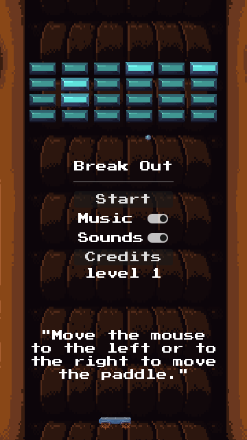

# Independent-author config-only trial: Breakout (#263, Part B of #259)

**Result: gameplay onboarding failed.** The configured game replays, but neither
the generated route nor the attempted keyboard route starts a playable round or
steers the paddle. The seeded physics defect is not exercised. No core code was
changed to get a better result, and the game was not swapped for another.

## Frozen selection and eligibility

[mike0697/Breakout](https://github.com/mike0697/Breakout), full pin
`0ac7aed444ea593a023d9b666c211d7ab8acd51e`, was selected before any scene/script or
README inspection: [frozen rationale](choice.json), [pin and licence](pin.json).
It is an independent individual's paddle-and-ball game, unlike the earlier demo
projects. The pinned [MIT licence](https://github.com/mike0697/Breakout/blob/0ac7aed444ea593a023d9b666c211d7ab8acd51e/LICENSE)
names Michele Pizzeghello (2025). `project.godot` declares Godot 4.4; the fetched
tree has six GDScript files and no `.cs`/`.csproj`. The README credits audio from
another project; no game source, audio or assets are vendored in Expectrail.

## Commands, time and stops

[Every numbered onboarding command, output/stop and next action](commands.md)
([machine-readable log](commands.json)). The 37 numbered commands took
**192.859 subprocess seconds** in total; elapsed time from the first logged
command to the last completion was 1133.558 seconds. These are machine
measurements from [timing.json](timing.json), not human minutes. Human minutes
were not measured. Repository-search/pin-lookup calls and artifact preparation
are outside that total. Corrections to the external logging/analysis helpers
and the malformed initial draft are recorded, not attributed to Expectrail.

1. Inspect/init found Paddle and Ball and requested a binding choice. A manual
   draft config bound the existing `Paddle` and `Ball` nodes and texture files.
2. Auto-route replayed its pause-only route three times identically, but explicitly
   reported no movement/useful coverage ([output](evidence/cli/16-auto-route.txt)).
3. The manual route tries Tab/focus-next, Enter/accept, then pause/resume. It still
   stays on the Start menu. The route contract cannot encode mouse positions or
   clicks. The paddle reads the viewport mouse position; the round remains paused.
4. Doctor's display/disk stops were resolved using existing display binaries and
   the documented temporary-folder variables. Actual runs used Godot 4.7.2,
   OpenGL3 and llvmpipe LLVM 19.1.7. This host cannot start nested bubblewrap:
   captures are explicitly **diagnostic, not isolated**.
5. All CLI jobs retain `draft: true`, two unapproved checks and no vision settings.
   They run zero approved checks. Separate engine diagnostics are shown below;
   they are not gate clearance.
6. The outside-trial list refuses repository-root `path: "."`. This project is
   not added to the working list. [Follow-up issue texts](issues.md) cover pointer
   routes and root/config-overlay registration; nothing was filed on GitHub.

## Pinned, harmless and broken

The harmless patch adds a comment. The broken patch sets the paddle x position
to 8 after its physics step, which would put part of its drawing outside the
left edge when physics runs. Both patches applied and reverse-checked. Source,
patch and config evidence is in [trial inputs](../../../tests/outside/breakout/README.md).

| Copy | Actual CLI verdict | Approved checks run | Draft paddle-bounds diagnostic | Draft ball-launch diagnostic | Distinct paddle positions / ball boxes |
| --- | --- | --- | --- | --- | --- |
| pinned | needs-review | 0 | needs-review / not-exercised | fail at frame 40, 104 px | 1 / 1 |
| harmless | needs-review | 0 | needs-review / not-exercised | fail at frame 40, 104 px | 1 / 1 |
| broken | needs-review | 0 | needs-review / not-exercised | fail at frame 40, 104 px | 1 / 1 |

The values and exact reasons are in [results.json](results.json). Each variant's
`job.json`, `gate-findings.json`, `trace.json`, `replay.json`, observations and
unapproved-draft diagnostic verdicts are under [pinned](evidence/pinned/job.json),
[harmless](evidence/harmless/job.json) and [broken](evidence/broken/job.json).
The three 120-tick traces are byte-identical. All positions remain at the menu:
paddle `[168, 616]`; ball drawing `[212, 196, 220, 204]`. Their world/screen boxes
and engine visibility were measured by the config-driven role recorder.

The bounds draft records a never-reached checkpoint and cannot pass. The launch
draft's assertion fails equally on all three copies: the ball never launched.
The evaluator preserves counterexamples even when that checkpoint is not reached.
**This is not evidence that the seeded bug was detected.** Do not approve the
launch draft in this state or treat either diagnostic as an accepted verification.
No visual client was asked; no model spend occurred. No claim beyond these runs
is made about correctness or repeatability under active play.

Screenshot of the pinned MIT game, copyright Michele Pizzeghello; not a visual
observer's answer. The ZIP retains all diagnostic capture frames.

## What Sean would review, and what remains

The two draft checks concern this game's paddle staying wholly inside the play
area after entering the left lane, and its ball leaving the launch area after
starting. [The drafts](../../../tests/outside/breakout/checks/) have no approval;
config policy merely lists them. Sean would be approving their objects, timing,
checkpoint, coordinate system and intended behaviour—not the fact that the
JSON validates. They are **not ready for approval** while the route cannot start
and steer a round.

Next: use [issues.md](issues.md) to assign pointer-input support and root-project
trial registration. Re-run the same pin and patches after those changes; preserve
the failed trial as history. Only then review useful checks, run isolated Linux
verification and arrange any live calibration/vision separately. No approvals,
workflow changes, CI dispatches or live calls were made here. No first-user test
or native macOS run was performed.

[Core audit](core-unchanged.json): 287 safe-named files under `expectrail/`,
`harness/`, `agents/` and `tools/` match the delivered Part A tree byte-for-byte.
The original upstream tracked files also remain unchanged. See the work log and
handover for full-suite before/after results.
