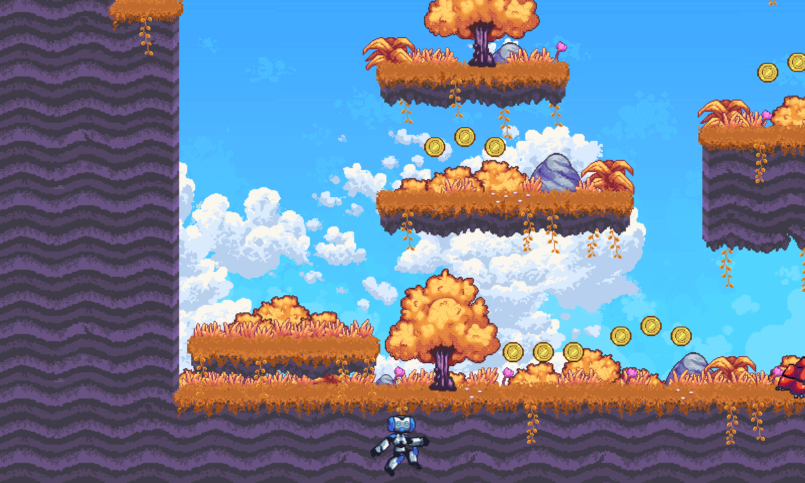

# Bring a playtest report to Expectrail

A report says what a player saw and supplies the inputs needed to try it again.
It is not a check or an approval. Expectrail replays from the game's start; it
does not restore a saved state or trust the report's claim that a bug happened.

The JSON format is `expectrail.playtest-report/v1`. It contains a report id,
producer name/version, the played project's Git commit, a route of at most 1,800
physics ticks, the bug in the player's words, and a position just before the
fault: object, tick, world x/y and allowed distance in pixels. Unknown fields,
state snapshots and unsupported engines are refused. Godot is supported today.
See the [schema](../contracts/playtest-report.v1.schema.json) and the
[handwritten fall-through report](../contracts/examples/playtest-report-fall-through.json).
The target commit must match the actual project checkout.

```sh
expectrail ingest report.json --project /path/to/project --json
```

The project configuration supplies the checks and normal routes. The report adds
its route and its anchor obligation; its words cannot remove a check, choose a
weaker one or approve a new one. By default this command does not start a fixer.

## Read the result

These are the three cases in the real-engine demonstration:

| What happened | What the record says | What it means |
| --- | --- | --- |
| The base reached the anchor and an approved check failed on all three runs | Reproduction kind `approved` — “approved check” | There is a reproducible approved-check failure. This has not proved a repair. |
| The base reached the anchor and all applicable checks passed on all three runs | `not-reproduced`, kind `none`, needs-review | These checks did not reproduce the report. It does not prove the reported bug is imaginary. |
| The base missed the anchor by more than its tolerance | `anchor-desync`, kind `none`, needs-review | The replay did not reach the reported starting point for the fault. No repair starts. |

Missing observations, incomplete checks or unstable results also need review;
they do not count as passes. The ordinary verifier requires both its engine and
visual observations for acceptance. A report reproduction is distinct from a
gate decision on a candidate change.

## Try an advisory check with `--propose`

```sh
expectrail ingest report.json --project /path/to/project --propose --json
```

When no approved check fails, this opt-in can ask the existing generated-check
path to propose a check from the bug report and route. A kept reproduction must
fail all three base replays and pass all three clean replays under the existing
stable keep rule. Its kind is `generated-advisory`. It never accepts or rejects a
change and cannot start repair until a person approves an appropriate check.

The default clean reference and mechanics profile describe the bundled game;
use `--clean-project` and `--profile` for another project. A live proposer needs
the existing explicit `EXPECTRAIL_SPEC_USD_CAP`. A saved `--proposal-response`
uses a stand-in with no live fallback. The minimal wheel may lack JIT; in that
case the result says generated checks are unavailable.

The trace proposal path has at most one proposer request per eligible report,
no automatic revision, and a default $2 JIT budget shared with replay estimates.
Token prices in that budget are assumptions, not a measured provider bill. The
code also enforces the spec-role cap. See [proposal limits and the unexecuted
estimate](playtest-propose.md). No live-model proposal quality or cost has been
measured for ingest.

## Try a fix with `--repair`

```sh
expectrail ingest report.json --project /path/to/project --repair --json
```

Only an approved check that failed all three anchored base replays is eligible
for the existing fix loop. Muse/BYO CLI startup is refused with
`fixer-bound-unavailable`. The trusted option `--repair-agent llm-patch` enables
recorded OpenAI GPT-4o text pricing, pre-send reservations and an output cap.
See [the bounds, caveats and $8.75 cap envelope](llm-patch-spend.md).
Offline saved patches remain usable. Advisory-only reproduction, `not-reproduced` and
`anchor-desync` do not construct a fixer transport. The loop writes a machine
candidate and asks the gate to judge it afresh. Only that gate can accept it.
A candidate advisory-discovery flag stops for review, with the flag named;
held-out checks may veto but never supply fixer or retry evidence.

Repair is foreground only. Its default is three candidate attempts, with a
maximum of ten through `--repair-attempts`. A live fixer needs
`EXPECTRAIL_MUSE_USD_CAP`; each fresh verification can also spend against its
visual-observer cap. The $1 Muse hold is per fixer invocation, not a cap on the
model requests or token bill inside that invocation. `--repair-fixture PATCH`
uses a saved patch without a fixer model; candidate verification may still need
paid vision unless it has a suitable offline observer. See the
[repair boundary and unexecuted cost estimate](ingest-repair.md).

Plain ingest costs engine/runner time and, when configured, visual-observer
calls. It makes no proposer or fixer call by default. The model-free diagnostic
below uses engine observations only, so it has no paid API cost. None of these
estimates is a live-model measurement.

## Open or repeat the real-engine demonstration

The handover zip contains `evidence/index.html`, with the report, the three base
check results, real traces, original replay manifests and selected PNG frames.
The [small source record](playtest-evidence/fall-through.json) states the run's
scope and result. All three diagnostic tests passed on Godot 4.7.2 in 302.402
seconds, with zero model/fixer boundary calls.


 The bug is the public `bugs/physics-fall-through/v1.patch`;
the existing ground check is copied unchanged. The clean control changes only
the report's target commit to match the unpatched disposable checkout. The anchor
control moves x by three pixels against a two-pixel tolerance.

With the pinned Godot, Xvfb, patch and Bubblewrap installed, run from a source
checkout, choosing an empty output directory:

```sh
python3 -m tools.playtest_fall_through --out runs/playtest-proof --sandbox require
```

The proof command invokes the real ingest CLI/store/worker/judge/evaluator. It
selects the existing bundled-game engine-only collision/position observer
(`project=None` at the harness boundary); it does not replace traces or invent
observations. This is a diagnostic of the public bug, not a test of configured
drawing-role bounds, live vision, model proposal quality or an accepted repair.
Model constructors, HTTP sending, proposal and fixer boundaries are blocked and
counted. Frames are real captures, with only frames 0, 8, 16 and 40 retained per
replay; the manifests describe each full original capture.

CI already collects `PlaytestIngestRealEngineTest` in `tests.test_replay_sandbox`:
the `seeded-bugs` job installs Godot/Xvfb/patch/Bubblewrap and sets
`EXPECTRAIL_SANDBOX_TESTS=required`. Its existing `run-it-offline` artifact uploads
`runs/run-it`, including `playtest-ingest/index.html`. No workflow change is
needed. Missing tools fail that required lane; the three tests skip by name in
normal runs. This handover does not claim that the future CI job has run.

For an explicitly unsandboxed local diagnostic when user namespaces are blocked:

```sh
EXPECTRAIL_PLAYTEST_DIAGNOSTIC=1 \
EXPECTRAIL_PLAYTEST_EVIDENCE=/tmp/expectrail-playtest-proof \
python3 -m unittest tests.test_replay_sandbox.PlaytestIngestRealEngineTest -v
```

This opt-in uses real Godot and makes the lack of isolation explicit. The required
CI switch always takes precedence and requires Bubblewrap. No live model or
fixer run, general report-filtering rate, or end-to-end live repair rate is proved.
